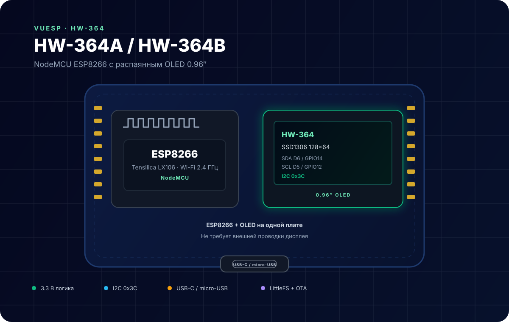
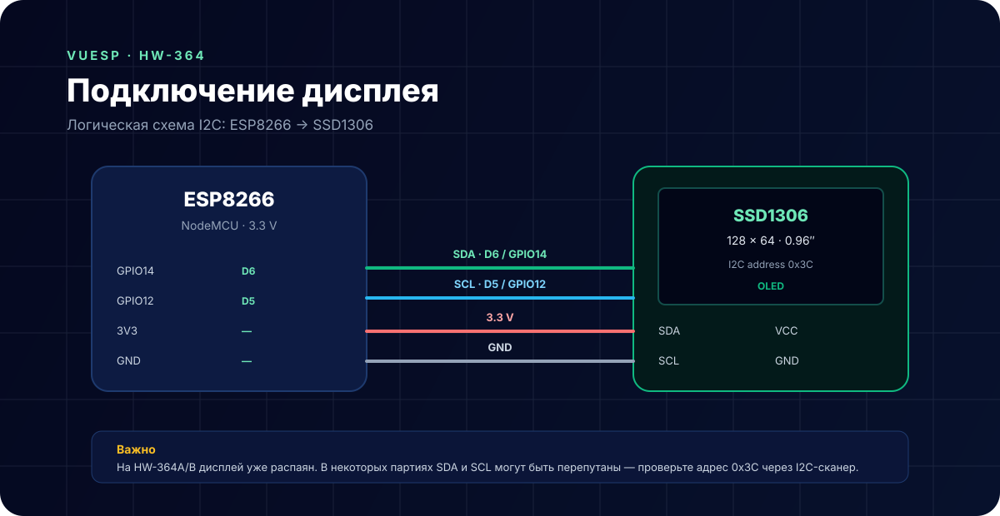
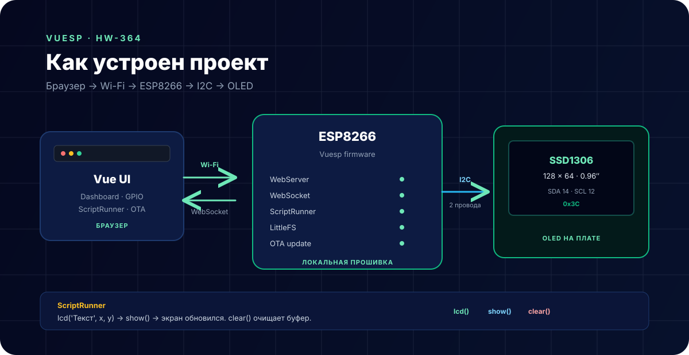

# HW-364A / HW-364B — ESP8266 с OLED 0.96″



**Коротко:** HW-364 — это не отдельный OLED-модуль, а готовая плата NodeMCU на ESP8266 с уже распаянным дисплеем SSD1306 128×64. В проекте Vuesp она работает как локальный веб-интерфейс с экраном, Wi-Fi, ScriptRunner и обновлением по воздуху.

## Что это за устройство

HW-364A и HW-364B — две версии одной платы. Отличаются разъёмом питания и прошивки:

| Версия | Разъём |
| --- | --- |
| HW-364A | USB-C |
| HW-364B | micro-USB |

На плате установлены:

- ESP8266 (ESP-12E) с Wi-Fi 2.4 ГГц;
- OLED-дисплей 0.96″ на контроллере **SSD1306**, 128×64 точек;
- USB-UART для прошивки и питания;
- стабилизатор 3.3 В;
- кнопки `RESET` и `FLASH`;
- гребёнки с выводами GPIO.

Дисплей подключён к ESP8266 по I2C и не требует внешней проводки. На некоторых платах встречаются дополнительные датчики (например, AHT20/BMP280) — проверяйте конкретную ревизию.

## Характеристики

| Параметр | Значение |
| --- | --- |
| Микроконтроллер | ESP8266 (Tensilica LX106, 80/160 МГц) |
| Wi-Fi | 802.11 b/g/n, 2.4 ГГц |
| Flash | зависит от платы, обычно 4 МБ |
| Дисплей | OLED 0.96″, SSD1306, 128×64 |
| Интерфейс дисплея | I2C |
| Адрес I2C | `0x3C` |
| Питание | 3.3 В (через USB или стабилизатор) |
| Логика | 3.3 В |
| Среда | PlatformIO + Arduino framework |

## Распиновка

Для дисплея используются две линии I2C:

| Сигнал | Пин NodeMCU | GPIO |
| --- | --- | --- |
| SDA | D6 | GPIO14 |
| SCL | D5 | GPIO12 |
| VCC | 3V3 | 3.3 В |
| GND | GND | GND |

В прошивке проекта это зафиксировано в `src/device/device.cpp`:

```cpp
Wire.begin(14, 12);
display.begin(SSD1306_SWITCHCAPVCC, 0x3C);
```

## Схема подключения



На HW-364A/B дисплей уже соединён с ESP8266 на плате. Схема выше показывает логику подключения: SDA — GPIO14, SCL — GPIO12, адрес `0x3C`.

> **Важно.** В разных партиях плат встречаются перепутанные SDA/SCL. Если экран не инициализируется, просканируйте I2C-шину и проверьте адрес `0x3C`. Также не используйте GPIO12 и GPIO14 как обычные выходы/PWM — они заняты дисплеем.

## Как устроен проект



Прошивка Vuesp поднимает на ESP8266:

- локальный веб-сервер и WebSocket;
- dashboard с портами и датчиками;
- ScriptRunner для сценариев;
- LittleFS для веб-интерфейса и файлов;
- OTA-обновление прошивки и файловой системы.

Браузер открывает веб-интерфейс по IP платы, управляет портами и отправляет команды. ScriptRunner может выводить текст на OLED через функции `lcd`, `show` и `clear`.

## Функции ScriptRunner

| Функция | Назначение |
| --- | --- |
| `lcd('text', x, y)` | записать строку в буфер дисплея в позицию `x`, `y` |
| `show()` | отправить буфер на OLED |
| `clear()` | очистить буфер дисплея |

Пример вывода текста:

```text
clear();lcd('Vuesp',0,0);lcd('HW-364 ready',0,18);show();
```

Пример по нажатию кнопки:

```text
on('btn');
  clear();
  lcd('Button pressed',0,0);
  show();
end;
```

Строки в ScriptRunner — только в одинарных кавычках. Команды разделяются `;`.

## Сборка и прошивка

```bash
cd vue
npm ci
npm run build-web

cd ..
~/.platformio/penv/bin/pio run
~/.platformio/penv/bin/pio run -t buildfs
```

Прошивка: `build/esp8266/firmware.bin`, файловая система: `build/esp8266/littlefs.bin`.

Полная сборка (web + прошивка):

```bash
cd vue
npm run build
```

## Ограничения

- GPIO12 (D5) и GPIO14 (D6) заняты I2C-дисплеем.
- GPIO17 (A0) — единственный аналоговый вход.
- Питание логики 3.3 В: не подавайте 5 В на GPIO.
- Перед прошивкой проверьте ревизию платы: HW-364A и HW-364B отличаются USB-разъёмом.
- SDA/SCL в некоторых партиях могут быть перепутаны — проверяйте сканером I2C.

## Источники

- [NodeMCU ESP8266 с OLED 0.96″ — руководство](https://manuals.plus/ae/1005006272605417)
- [peff74/esp8266_OLED_HW-364A — примеры и распиновка](https://github.com/peff74/esp8266_OLED_HW-364A)
- [ESP8266 OLED HW-364A/B Development Guide](https://osrtos.com/projects/esp8266-oled-hw-364a-b-development-guide)
- [Документация Vuesp](https://docs.vuesp.ru)
