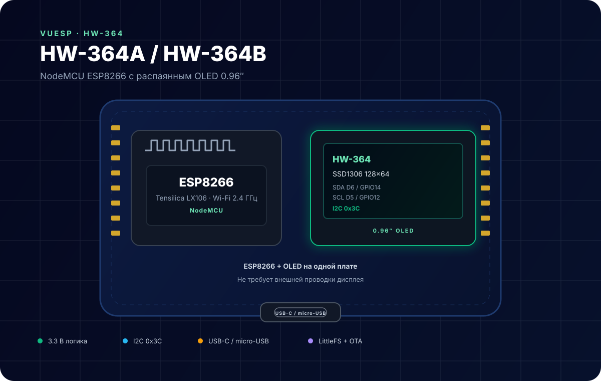

# vuesp.hw364



OLED-дисплей HW-364, функции `lcd`, `show`, `clear` и управление выводами.

Проект собран на базе шаблона [Vuesp](https://github.com/bondrogeen/vuesp): прошивка PlatformIO + web UI на Vue 3 и `vuesp-components`.

## Документация

Подробное описание платы, распиновка, схема I2C, примеры ScriptRunner и ограничения — в [DOCS.md](./DOCS.md).

## Плата и окружение

- PlatformIO env: `esp8266`
- Прошивка: `platformio.ini`
- Web UI: `vue/`
- Файловая система: LittleFS, веб-сборка попадает в `data/www`

## Сборка

```bash
cd vue
npm ci
npm run build-web
```

Полная сборка (web + прошивка):

```bash
cd vue
npm run build
```

Либо отдельно:

```bash
~/.platformio/penv/bin/pio run
~/.platformio/penv/bin/pio run -t buildfs
```

## Возможности

- локальный веб-интерфейс без облака;
- настройка Wi-Fi, безопасности, GPIO и файловой системы;
- dashboard с плитками устройств;
- сценарии и автоматизация;
- обновление прошивки и файловой системы через веб-интерфейс.

## CI

GitHub Actions собирает web UI, прошивку и LittleFS для указанных env, запускает тесты ScriptRunner и публикует артефакты в релиз при пуше тега.

## Репозиторий

<https://github.com/bondrogeen/vuesp.hw364>
